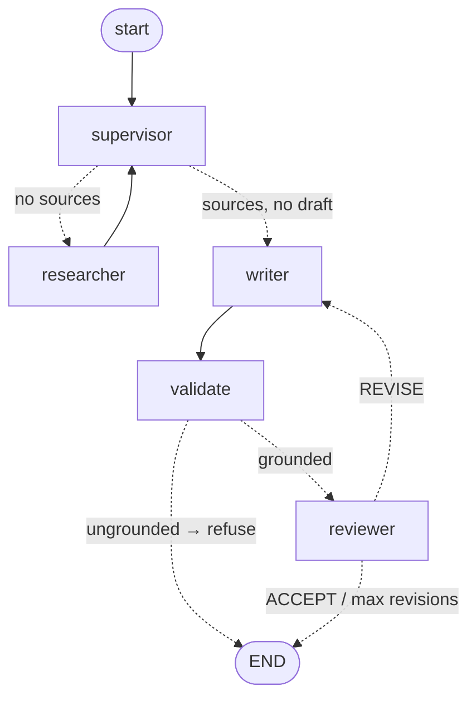

 Multi-agent-assistant
 
This AI application uses **[LangGraph](https://github.com/langchain-ai/langgraph)** to turn one question into a polished, research-backed report. Three specialist agents — a **Researcher**, a **Writer**, and a **Reviewer** — work together, while a central **Supervisor** coordinates their work through a stateful graph.

The project showcases the **supervisor / orchestrator-worker pattern** for agentic systems, conditional edges for dynamic LLM-driven routing, iterative refinement between Writer and Reviewer, tools for live web search, and a **provider-agnostic** LLM layer. Choose Groq, Gemini, OpenAI, or Anthropic using a single environment variable.

---

## ✨ Features

- **Coordinated agents** — specialists collaborate as nodes within a LangGraph `StateGraph`.
- **State-aware supervisor** — a coordinator selects the next agent based on shared state rather than following a rigid, hard-coded sequence.
- **Evidence-based answers or refusal** — the Writer cites retrieved material with footnote markers (`[^n]`). A **deterministic `validate` node** blocks drafts that lack sources or citations, or cite nonexistent or empty sources. Read the [incident write-up](docs/incident-hallucination.md) to learn *why* this safeguard exists.
- **Repeatable review cycle** — the Writer and Reviewer refine the draft until it is accepted or reaches `MAX_REVISIONS`. Deterministic termination ensures the cycle halts.
- **Current web research** — the Researcher uses keyless **DuckDuckGo** search and retrieves page text, passing structured sources (title, URL, content) through the graph.
- **LLM provider choice** — switch `LLM_PROVIDER` to use **Groq** (the free default), **Gemini**, **OpenAI**, or **Anthropic**.
- **Live progress** — the terminal displays each graph node's progress as it runs.
- **Optional human review** — `--human-review` pauses execution with LangGraph `interrupt` and a `MemorySaver` checkpointer, allowing a person to accept or request a revision in place of the model's decision. Since the human controls this loop, a requested revision is honored even after `MAX_REVISIONS`. Continue with `Command(resume=...)`.
- **Built-in observability** — when environment variables are configured, LangSmith automatically traces each LLM and graph step; startup indicates whether tracing is enabled.
- **Free to start** — the free Groq tier and keyless search let you run the project without a paid API or credit card.

---

## 🏗️ Architecture



> The diagram is produced directly from the compiled graph:
> `build_graph().get_graph().draw_mermaid()`.

Two design decisions are especially important:

- **The Supervisor coordinates the initial stages** (research → first draft), but it does **not** determine when execution ends. After a draft is created, the flow is `writer → validate → reviewer`. The **Reviewer's verdict ends or continues the cycle deterministically** through `route_after_review`, instead of relying on the LLM Supervisor to recognize "ACCEPT." Letting the LLM control termination previously caused a near-infinite loop.
- **`validate` is a deterministic check, not an agent.** The LLM *proposes* a draft, and plain Python *decides* whether its grounding is sufficient to publish. Not every step in an agent graph needs a model call; straightforward, testable code is often a better fit. This gate turns a "confident hallucination" into either a grounded response or an honest refusal.

### What each agent does

| Agent | Responsibility | Tools |
|---|---|---|
| **Supervisor** | Checks shared state and directs the initial work, from research through the first draft. | LLM-based routing |
| **Researcher** | Finds web results and retrieves page text, storing structured sources (title, URL, content) in state to retain their provenance. | `web_search` (DuckDuckGo + page fetch) |
| **Writer** | Builds a markdown report from the sources, **citing every claim with `[^n]`**, and applies Reviewer feedback during revisions. | LLM generation |
| **Validate** | **Deterministic (no LLM).** Rejects drafts without sources or citations, with dangling citations, or with citations to sources that have no content. | plain Python |
| **Reviewer** | Assesses the draft's accuracy, clarity, and completeness, then returns an **ACCEPT** or **REVISE** decision to end or continue the cycle deterministically. | LLM evaluation |

---

## ⚙️ How it works

The application runs as a **state machine**. One typed `AgentState` object moves through the graph; each node returns a partial update for LangGraph to merge into that state.

**Fields shared through `AgentState`:**

| Field | Purpose |
|---|---|
| `messages` | The conversation history, appended using the `add_messages` reducer. |
| `sources` | Researcher-retrieved `{title, url, snippet, content}` records that provide evidence for the report's claims. |
| `research_notes` | A numbered, URL-preserving summary of the sources provided to the Writer. |
| `draft` | The Writer's current report, including footnote citations in the form `[^n]`. |
| `review_feedback` | Reviewer comments that the Writer uses and clears during each revision. |
| `verdict` | The Reviewer's persisted `ACCEPT`/`REVISE` decision, which makes routing deterministic. |
| `validation_error` | Set by `validate` when a draft lacks grounding; causes the run to refuse the draft. |
| `next_agent` | The agent selected by the Supervisor. |
| `revision_count` | The number of revision cycles completed; the loop is capped at `MAX_REVISIONS` (3). |

**Steps taken for each query:**

1. With no sources in state, the **Supervisor** sends the query to the **Researcher**.
2. The **Researcher** searches for information and fetches pages, then populates `sources` and `research_notes`.
3. When sources are available but no draft exists, the **Supervisor** selects the **Writer**.
4. The **Writer** creates a report with `[^n]` citations and stores it in `draft`.
5. **Validate** checks the report's grounding deterministically. An `ungrounded` result ends the run with a refusal; a `grounded` result proceeds to the **Reviewer**.
6. The **Reviewer** evaluates the draft and records an `ACCEPT` or `REVISE` verdict in state.
7. `REVISE` sends the draft back to the **Writer**. `ACCEPT` or reaching `MAX_REVISIONS` leads to **END**.

---

## 🧩 Technologies

| Component | Technology |
|---|---|
| Orchestration | [LangGraph](https://github.com/langchain-ai/langgraph) (`StateGraph`, conditional edges) |
| LLM abstraction | [LangChain](https://github.com/langchain-ai/langchain) (`langchain-core`) |
| LLM — Groq (default) | Llama 3.3 70B via `langchain-groq` |
| LLM — Gemini | `gemini-2.5-flash-lite` via `langchain-google-genai` |
| LLM — OpenAI | GPT-4o via `langchain-openai` |
| LLM — Anthropic | Claude Sonnet 4.5 via `langchain-anthropic` |
| Web search | [DuckDuckGo](https://duckduckgo.com/) (`ddgs`) via `langchain-community` — no API key |
| Page fetching | `httpx` + stdlib HTML parsing (best-effort, falls back to snippets) |
| State & validation | [Pydantic v2](https://docs.pydantic.dev/) |
| Configuration | `python-dotenv` |
| Build backend | [Hatchling](https://hatch.pypa.io/) |
| Package manager | [uv](https://github.com/astral-sh/uv) |
| Linting | [Ruff](https://github.com/astral-sh/ruff) |
| Containerization | Docker (Python 3.12 slim) |

---

## 🚀 Set up and run

### Requirements
- Python **3.12+**
- [uv](https://github.com/astral-sh/uv) (`curl -LsSf https://astral.sh/uv/install.sh | sh`)
- A free LLM API key (Groq recommended — no credit card)

### Installation and use

```bash
# 1. Clone
git clone https://github.com/<your-username>/langgraph-multi-agent.git
cd langgraph-multi-agent

# 2. Configure environment
cp .env-template .env
# Edit .env and add your GROQ_API_KEY (free at https://console.groq.com/keys)

# 3. Install dependencies (creates .venv)
uv sync

# 4. Run a research query
uv run python main.py "What are the latest breakthroughs in quantum computing?"

# Verbose mode prints the full output of every agent
uv run python main.py --verbose "Explain the current state of nuclear fusion energy"

# Human-in-the-loop: pause for your approve/revise decision before finishing
uv run python main.py --human-review "How do I connect Langfuse to LangGraph?"
```

---

## 🔧 Configuration

Choose a provider by setting `LLM_PROVIDER` in `.env`, then provide the corresponding API key:

| Variable | Required | Description |
|---|---|---|
| `LLM_PROVIDER` | No | `groq` (default), `gemini`, `openai`, or `anthropic` |
| `GROQ_API_KEY` | If `groq` | [Groq](https://console.groq.com/keys) — free tier, no credit card |
| `GOOGLE_API_KEY` | If `gemini` | [Google AI Studio](https://aistudio.google.com) |
| `OPENAI_API_KEY` | If `openai` | OpenAI |
| `ANTHROPIC_API_KEY` | If `anthropic` | Anthropic |
| `LLM_MODEL` | No | Override the provider's default model |
| `LANGSMITH_TRACING` | No | Set to `true` (with `LANGSMITH_API_KEY`) to trace every step in [LangSmith](https://smith.langchain.com) |

> **DuckDuckGo** powers web search, and no API key is needed for it.

---

## 🔭 LangSmith tracing

**[LangSmith](https://smith.langchain.com)** can record each LLM call and graph transition, including the complete `supervisor → researcher → writer → validate → reviewer` tree, token counts, latencies, and each node's inputs and outputs. Instrumentation is automatic: configure the environment variables without adding tracing code.

**Configure tracing (~2 minutes; the free tier requires no card):**

1. Create a key at [smith.langchain.com](https://smith.langchain.com) → *Settings → API Keys → Create API Key* (`lsv2_...`).
2. Add to your `.env`:
   ```bash
   LANGSMITH_TRACING=true
   LANGSMITH_API_KEY=lsv2_your_key_here
   LANGSMITH_PROJECT=langgraph-multi-agent   # optional; defaults to "default"
   ```
3. Run normally — the startup banner confirms it:
   ```text
   LangSmith tracing: ON (project='langgraph-multi-agent')
   ```
   The resulting traces will appear in the LangSmith UI for that project.

**How tracing works:** The application loads `.env` with `load_dotenv()` in `agents/config.py` *before* making its first LLM call. LangChain and LangGraph then detect the variables and send traces automatically. In project code, only the startup status line in `main.py` relates to tracing; the frameworks provide the instrumentation.

**Notes:**
- LangChain already includes `langsmith`, so **no additional installation is needed**.
- Keep `LANGSMITH_TRACING` unset or set to `false` until you have a key. Without a valid key, enabling tracing prevents uploads and adds a small amount of latency.
- The older variable names `LANGCHAIN_TRACING_V2` and `LANGCHAIN_API_KEY` are supported too; the startup check recognizes both sets.

---

## 📤 Example output

```text
$ uv run python main.py "How do I connect Langfuse to LangGraph?"

============================================================
  Research query: How do I connect Langfuse to LangGraph?
  LangSmith tracing: off (set LANGSMITH_TRACING=true + LANGSMITH_API_KEY to enable)
============================================================

--- [SUPERVISOR] ---   [Supervisor] Routing to: researcher
--- [RESEARCHER] ---   [Researcher] Retrieved 5 source(s).
--- [SUPERVISOR] ---   [Supervisor] Routing to: writer
--- [WRITER] ---       [Writer] Draft produced (2740 chars)
--- [VALIDATE] ---     [Validate] grounded
--- [REVIEWER] ---     [Reviewer] Verdict: REVISE
--- [WRITER] ---       [Writer] Draft produced (5606 chars)
--- [VALIDATE] ---     [Validate] grounded
--- [REVIEWER] ---     [Reviewer] Verdict: ACCEPT

============================================================
  FINAL REPORT
============================================================

## Overview
Langfuse is an open-source LLM-engineering platform that traces API calls,
manages prompts, and runs evaluations [^4][^5]. ...

## Sources
[1] Open Source Observability for LangGraph - Langfuse — https://langfuse.com/guides/cookbook/integration_langgraph
[4] Langfuse integrations - Docs by LangChain — https://docs.langchain.com/oss/python/integrations/providers/langfuse
[5] Get Started - Langfuse — https://langfuse.com/docs/observability/get-started
```

> Each claim is accompanied by a `[^n]` citation, and the report concludes with a `## Sources` list.
> When the system cannot ground an answer, it displays an **INSUFFICIENT GROUNDING** notice
> and returns a non-zero exit code rather than making something up.

---

## 🐳 Docker

```bash
docker build -t research-assistant .
docker run --env-file .env research-assistant "Your research query here"
```

The container is built in multiple stages and uses `uv` to install dependencies quickly and reproducibly on a `python:3.12-slim` base image.

---

## 📁 Repository layout

```
langgraph-multi-agent/
├── agents/
│   ├── __init__.py
│   ├── config.py      # Provider-agnostic LLM factory (Groq/Gemini/OpenAI/Anthropic)
│   ├── graph.py       # AgentState, agent nodes, routing, and StateGraph assembly
│   └── tools.py       # Custom tools: web_search (DuckDuckGo) + summarize
├── main.py            # CLI entry point — builds and streams the graph
├── pyproject.toml     # Project metadata, dependencies, tooling config
├── Dockerfile         # Multi-stage container build
├── .env-template      # Environment variable template
└── README.md
```

---

## 🧠 Design overview

- **Supervisor / orchestrator-worker pattern** — one central node directs specialist workers, making the workflow easy to extend: add an agent by adding a node and a routing branch.
- **Conditional routing** — `add_conditional_edges` lets the Supervisor choose the next node at runtime based on state instead of fixing the sequence when building the graph.
- **Reducers** — LangGraph's `add_messages` reducer appends to `messages`; by default, updates to other fields replace their previous values.
- **Loop termination** — `revision_count` and `MAX_REVISIONS` ensure that the Writer-Reviewer cycle ends.
- **Factory + Strategy** — `get_llm()` provides one interface for constructing the selected provider and uses lazy imports so only that provider's SDK is needed.

## 🗺️ Ideas for future work

- **Semantic grounding** — `validate` verifies that citations *resolve*, but not that the cited text *supports* each claim. An entailment check or LLM-as-judge could address this limitation.
- **Structured routing** — use structured output, such as function calls or Pydantic schemas, instead of parsing prose verdicts for more dependable control flow.
- **Persistent state** — replace the in-memory `MemorySaver` with a SQLite/Postgres checkpointer to support pauses and resumes across restarts and multi-turn sessions.
- **Parallel research** — run searches and page retrieval concurrently; they are currently sequential.
- **Supervisor hop limit** — introduce an explicit hop counter. At present, `MAX_REVISIONS` limits only the Writer-Reviewer loop.

---

## 📄 License

MIT
